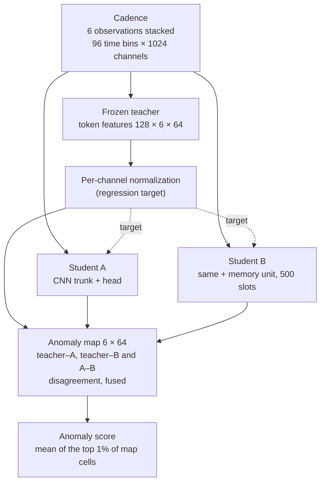
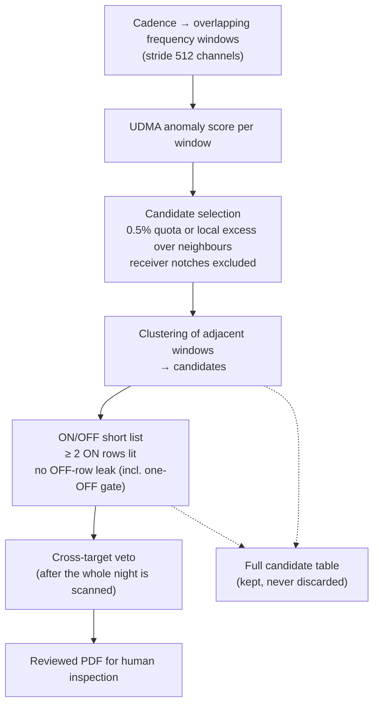

# Platypus

Unsupervised anomaly detection pipeline for searching technosignatures in Green Bank Telescope (GBT) observations of sources from the [Breakthrough Listen Exotica Catalog](https://arxiv.org/abs/2006.11304) (Lacki et al. 2020).

**Author:** Filippo Simone Zuddas (Uni. Cagliari)
**Mentors:** Maura Pilia, Vishal Gajjar
**Program:** Breakthrough Listen Summer Internship 2026

> **Status (2026-11):** active research code, work in progress. The scorer is
> **UDMA** (teacher–student feature distillation). Training, injection-recovery
> through the full search chain, and a development-set background scan are
> implemented and have been run for the narrowband `0000` product, on an
> observing-night split whose final reserve has not been opened. A comparison of
> teacher variants is in progress; `0001` and `0002` are not modelled yet.
> Results and known limitations are in [`docs/`](docs/README.md) — read
> [`docs/01_scoring-history.md`](docs/01_scoring-history.md) first for the
> context behind the current design.

## Motivation

Traditional SETI searches rely on matched-filter algorithms like [turboSETI](https://github.com/UCBerkeleySETI/turbo_seti), which are optimized for narrowband drifting signals. However, a genuine technosignature could have any morphology — wideband, pulsed, modulated, or transient. Searching for every possible signal type individually is impractical.

This project extends the autoencoder-based approach of [Ma et al. (2023)](https://arxiv.org/abs/2301.12670) to search for a **broader range of technosignature-like signals**. Instead of a supervised classifier (ContrastiveVAE + Random Forest) tied to known signal classes, the model is trained **without labels on real GBT noise and RFI**; a snippet whose morphology the model cannot reproduce is flagged as a candidate — no prior signal model required.

The search targets "exotica" sources: rare, extreme, or unusual astrophysical objects that expand SETI target lists beyond traditional nearby-star surveys.

## Method

Reconstruction error does not work as the score here: it measures how *predictable* a snippet is, not how anomalous, and a smooth drifting line can even lower it below the noise baseline ([`docs/01`](docs/01_scoring-history.md)). The scorer is therefore a feature-space one, **UDMA** (Unsupervised Distillation and Memory-enhanced Autoencoders, [Qi et al. 2024](#references)), adapted to GBT cadences:



- **Teacher.** A frozen ViT-MAE encoder trained self-supervised on radio spectrograms, read at transformer block 3. The teacher of the current reference model was trained on SRT cadences, not on GBT data. A distilled CNN teacher confined to one observation (`cnn_obs`) is under comparison.
- **Students.** Two CNNs trained, on normal noise and RFI only, to regress the teacher's features. On in-distribution data they reproduce the teacher and agree with each other; on unseen morphology they fail, and fail differently. There is no pixel decoder.
- **Grid rows ↔ observations.** One row of the `(6, 64)` map is one observation of the ABACAD cadence, which is what the downstream ON/OFF rules read.
- No classifier is trained and there is no ON/OFF training objective.

The design, the acceptance bars it was held to, and its deviations from the paper are in [`docs/02`](docs/02_udma-architecture.md). The earlier backbones (plain AE, CNN-MAE, VAE, MemAE, ViT-MAE as a scorer) are retired as scorers; their record is in [`docs/01`](docs/01_scoring-history.md) §8. Two of them live on as parts of UDMA: the ViT-MAE is the teacher and the memory unit is inside student B.

## Pipeline

1. **Unsupervised training.** Students are trained on night-disjoint training cadences from a snippet cache; the teacher is frozen and its normalization statistics are fitted offline on the same data.
2. **Search chain** (`src/search/`). A cadence is cut into overlapping frequency windows and each window is scored. The pipeline then selects candidates, clusters adjacent windows, applies the ON/OFF short-list rules, applies a cross-target veto across the targets of the same night and node, and exports a PDF of figures for human review. The selection stages are bundled in named rules (`RULES` in `src/search/pipeline.py`); the current one is `hybrid_v4` ([`docs/04`](docs/04_candidate-filtering.md)).
3. **Injection-recovery through the same chain.** An immutable catalog of synthetic signals (eight morphologies, SNR 0–100, ON patterns from three ON observations down to one) is written into the raw data of whole cadences, and the production search is run on the result. Completeness is the share of injected signals that reach the reviewed list, so it measures the pipeline, not only the model.

The search chain, stage by stage:



turboSETI is not part of the pipeline; a comparison against it is a possible final step.

## GBT data products

HDF5 filterbank files (`*.rawspec.000N.h5`) at three resolution levels, each targeting a different signal class:

| Suffix | Freq. resolution | Time resolution | Target signal class | Status |
|--------|-----------------|-----------------|---------------------|--------|
| `0000` | ~3 Hz/chan | ~18 s/bin | Narrowband drifting | Trained, searched on development nights |
| `0001` | ~364 kHz/chan | ~349 µs/bin | Broadband transients | Manifests and header census done; no model yet |
| `0002` | ~2.86 kHz/chan | ~1 s/bin | Wideband / modulated | Manifests and header census done; no model yet |

Observations follow an ABACAD cadence pattern (3 ON-source + 3 OFF-source), each ~308 s long. The three products share their scans, bands and start times.

**Split.** The `0000` product has 905 band-cadence rows (one recorder node's frequency coverage of one cadence) over 17 observing nights. The observing night is the indivisible unit, so every cadence, node and product of a night lands in the same set: **263 training rows, 299 development/calibration rows, 343 final-reserve rows**. The reserve is not used for training, thresholds or rule selection. The same split is carried over to `0001` and `0002` (263 / 541 / 343 rows; the extra development rows are one night with no `0000` counterpart). The manifests are `data/raw/gbt_{0000,0001,0002}_nightsplit_{train,devcal,final}.txt` and are not tracked.

## Installation

### With conda (recommended)

```bash
conda env create -f environment.yml
conda activate platypus
pip install -e .
```

On a CUDA-equipped machine, install the appropriate PyTorch build first:

```bash
pip install torch --index-url https://download.pytorch.org/whl/cu121
```

### With pip only

```bash
pip install -e ".[dev]"
```

**Requirements:** Python >= 3.10, PyTorch >= 2.2, PyTorch Lightning >= 2.2

Key dependencies: `setigen` (synthetic signal generation), `blimpy` (filterbank I/O), `h5py`, `astropy`, `scikit-learn`, `pypdf` (reviewed-PDF cutting), `pytorch-msssim` (optional SSIM loss variants).

### Data paths

A few paths belong to the machine hosting the GBT data and must be pointed at your own storage before anything will run:

- `configs/data/gbt_fine_nightsplit.yaml` → `dataset.train_cadence_list`, `dataset.val_cadence_list`, `dataset.cadence_list` (the manifests) and `dataset.cache_dir` (the snippet cache written by `scripts/preprocess_cache.py`)
- `configs/model/udma_nightsplit.yaml` → `teacher.checkpoint` (the ViT-MAE teacher) and `teacher.norm_stats`
- `scripts/debug/exotica_dist_analysis.py` → `DATA_DIR` (raw `.h5` batch)
- The exploration notebooks under `notebooks/` read the raw batch directly

Usage examples in docstrings use `/path/to/...` placeholders throughout.

## Usage

All commands run from the repository root with `PYTHONPATH=.` (or after `pip install -e .`). Hardware is config-driven: `hardware.num_gpus: 0` runs on CPU.

### 1. Snippet cache

```bash
python scripts/preprocess_cache.py \
    --data-config configs/data/gbt_fine_nightsplit.yaml \
    --output /path/to/cache_dir \
    --train-cadence-list data/raw/gbt_0000_nightsplit_train.txt \
    --val-cadence-list data/raw/gbt_0000_nightsplit_devcal.txt \
    --snippets-per-cadence 2200 --val-snippets-per-cadence 300

python scripts/verify_cache.py --cache /path/to/cache_dir \
    --train-cadence-list data/raw/gbt_0000_nightsplit_train.txt \
    --val-cadence-list data/raw/gbt_0000_nightsplit_devcal.txt
```

The cache records the identity of its manifests; training refuses a cache that does not match. `verify_cache.py` also re-reads a sample of snippets from the raw files and compares them exactly.

### 2. Teacher normalization, then training

The students regress the teacher's *normalized* features, so the per-channel statistics must exist before training:

```bash
python scripts/fit_udma_teacher_norm.py \
    --config configs/training/udma_gbt_fine_nightsplit.yaml \
    --out outputs/udma_teacher_norm/gbt_fine_nightsplit_block3.pt

python scripts/train.py --config configs/training/udma_gbt_fine_nightsplit.yaml
```

Outputs (checkpoints, logs, a `provenance.json` with data identity and git state) are written to `outputs/training/<run_id>/`.

### 3. Search on cadences

```bash
python scripts/inference.py \
    --checkpoint outputs/training/<run>/checkpoints/<name>.ckpt \
    --cadence_list /path/to/cadences.txt \
    --data_config configs/data/gbt_fine_nightsplit.yaml \
    --model_config configs/model/udma_nightsplit.yaml \
    --rule hybrid_v4 \
    --out_dir outputs/inference/run_name
```

Each cadence gets its own folder with its score and candidate tables and a ranked PDF of candidate figures (original | anomaly map). GPU scoring is deterministic by default (`--no_deterministic` turns it off).

### 4. Development scan, injections and the reviewed list

```bash
# Immutable injection catalog (reads only the manifest and the data config)
python scripts/build_injection_catalog.py \
    --manifest data/raw/gbt_0000_nightsplit_devcal.txt \
    --data_config configs/data/gbt_fine_nightsplit.yaml \
    --out outputs/injection_catalogs/<name> \
    --on_patterns 3on 2on_02 2on_04 2on_24 1on_2 --rows_per_night 8

# Background search of every row, plus the catalog's injections if one is given
python scripts/search_and_inject.py \
    --checkpoint outputs/training/<run>/checkpoints/<name>.ckpt \
    --model_config configs/model/udma_nightsplit.yaml \
    --data_config configs/data/gbt_fine_nightsplit.yaml \
    --manifest data/raw/gbt_0000_nightsplit_devcal.txt \
    --catalog outputs/injection_catalogs/<name> \
    --rule hybrid_v3 --out_dir outputs/recovery/<name>

# Final short list: re-decide the verdict under the rule, apply the cross-target
# veto, and cut the reviewed PDF
python scripts/cross_target_veto.py --rule hybrid_v4 \
    --manifest data/raw/gbt_0000_nightsplit_devcal.txt \
    --reference_dir outputs/devscan/<scan> --run_dir outputs/devscan/<scan>
```

Runs are resumable and tied to one checkpoint, manifest, catalog and rule: re-running into a directory with different ones is refused. The veto needs every cadence of the night, so it runs after the scan, not inside it. `hybrid_v4` differs from `hybrid_v3` only in its verdict fields, which is why the veto stage can re-decide a `hybrid_v3` scan under `hybrid_v4` from the saved anomaly maps.

### 5. Teacher variants and diagnostics

```bash
# Distill a CNN teacher from a frozen ResNet-18, confined to one observation
python scripts/distill_teacher.py \
    --config configs/training/udma_gbt_fine_cnn_obs.yaml --per_observation \
    --out outputs/udma_teacher_distill/cnn_obs_resnet18_nightsplit.pt

# Fitness gates for any new teacher checkpoint (run before training students)
python scripts/debug/teacher_sensitivity_test.py --help
```

The model configs `configs/model/udma_*.yaml` change one variable each (teacher, memory size, bottleneck); `udma_nightsplit.yaml` is the reference. `scripts/debug/` holds the diagnostics behind the decisions in `docs/` (see its README).

### 6. Data census

```bash
python scripts/scan_headers.py /path/to/exotica/ --product 0001 --out headers_0001.csv
python scripts/associate_products.py --headers headers_0001.csv headers_0002.csv \
    --headers_0000 headers_0000.csv --out_dir /path/to/out
```

`associate_products.py` attaches the `0001`/`0002` files to the night split of `0000` and writes draft manifests.

### Single-cadence injection test

`scripts/inject_recover.py` is the earlier, self-contained injection test: it injects ON-only narrowband signals into quiet windows of real cadences and ranks them against the real RFI background in-script. It does not go through the full search chain; use step 4 for completeness figures.

### CLI commands

After `pip install -e .`, these are available system-wide:

| Command | Description |
|---------|-------------|
| `bl-train` | Training entry point (`scripts/train.py`) |
| `bl-inference` | Search on real cadences (`scripts/inference.py`) |
| `bl-inject` | Single-cadence injection test (`scripts/inject_recover.py`) |
| `bl-preprocess` | Build the snippet cache (`scripts/preprocess_cache.py`) |

Each accepts the same arguments as the corresponding `python scripts/...` invocation.

## Repository layout

```
Platypus/
├── configs/
│   ├── data/                 # per-product data configs
│   │   ├── gbt_fine_nightsplit.yaml   # 0000, night-split manifests + cache (current)
│   │   ├── gbt_fine.yaml              # 0000, pre-split layout (historical)
│   │   ├── gbt_moderate.yaml          # 0002 (wideband)
│   │   ├── gbt_high_time.yaml         # 0001 (broadband)
│   │   └── synthetic*.yaml            # setigen-generated data
│   ├── model/
│   │   ├── udma_nightsplit.yaml       # reference UDMA model (current)
│   │   ├── udma_cnn_obs.yaml          # distilled CNN teacher confined to one observation
│   │   ├── udma_*.yaml                # one-variable ablations (memory, bottleneck, teacher)
│   │   └── convae*.yaml, memae.yaml, vit_*.yaml   # retired scorers / UDMA building blocks
│   ├── training/             # optimizer, hardware, one config per model variant
│   └── search/default.yaml   # legacy search settings
├── data/
│   ├── raw/                  # cadence manifests / symlinks (gitignored)
│   ├── synthetic/            # setigen-generated data
│   └── processed/            # snippet caches (gitignored)
├── src/                      # installable library
│   ├── data/
│   │   ├── loader.py             # blimpy Waterfall reader
│   │   ├── cache.py              # format-2 snippet cache: manifest identity, index, verification
│   │   ├── preprocessing.py      # per-observation bandpass correction + log1p + median/MAD
│   │   ├── torch_dataset.py      # SpectrogramDataset / CachedDataset
│   │   ├── synthetic.py          # setigen wrappers, ON-only injection
│   │   └── morphologies.py       # the eight injected signal classes
│   ├── models/
│   │   ├── udma.py               # UDMA: teacher + two students, loss, anomaly maps
│   │   ├── memory.py             # memory unit (student B)
│   │   ├── vit_mae.py            # ViT-MAE (the teacher's architecture)
│   │   ├── observation_fold.py   # apply a network to each observation separately
│   │   ├── autoencoder.py        # build_autoencoder() + retired AE / CNN-MAE / VAE
│   │   ├── encoder.py, decoder.py, losses.py
│   ├── training/
│   │   ├── trainer.py            # LightningModule + Trainer setup
│   │   ├── distill.py            # teacher distillation
│   │   └── callbacks.py
│   ├── search/
│   │   ├── pipeline.py           # windows, scoring, SelectionRule / RULES, short list
│   │   ├── candidates.py         # FAR quota, local statistics, clustering, ON/OFF diagnostics
│   │   ├── veto.py               # cross-target veto
│   │   ├── injection.py          # immutable injection catalog, injection into raw data
│   │   ├── recovery.py           # injection → candidate association, per-stage outcomes
│   │   ├── export.py             # candidate PDFs
│   │   └── scorer.py, vetting/
│   ├── product_association.py    # 0001/0002 ↔ 0000 night-split association
│   ├── product_inventory.py
│   └── utils/                    # config, logging, provenance, visualization
├── scripts/                  # thin CLI entry points
│   ├── train.py, fit_udma_teacher_norm.py, distill_teacher.py
│   ├── preprocess_cache.py, verify_cache.py
│   ├── inference.py, search_and_inject.py, build_injection_catalog.py, cross_target_veto.py
│   ├── inject_recover.py, recompute_anomaly_maps.py, pipeline_sensitivity.py
│   ├── scan_headers.py, associate_products.py
│   └── debug/                # diagnostics, not part of the pipeline (see scripts/debug/README.md)
├── docs/                     # design rationale and results (see docs/README.md)
├── tests/
├── notebooks/                # exploration only
├── outputs/                  # checkpoints, logs, results (gitignored)
├── environment.yml
├── pyproject.toml
└── requirements.txt
```

## Documentation

Code carries API documentation only. The reasoning behind the design — rejected
alternatives, hand-validated numbers, and experiments worth not repeating —
lives in [`docs/`](docs/README.md).

| Document | Covers |
|---|---|
| [`01_scoring-history.md`](docs/01_scoring-history.md) | **Start here.** Why reconstruction error fails, the scorer families that failed before UDMA, and the retired backbones |
| [`02_udma-architecture.md`](docs/02_udma-architecture.md) | The production model, its pre-registered acceptance bars, and how it relates to Qi et al. 2024 |
| [`03_teacher-localization.md`](docs/03_teacher-localization.md) | Why the teacher is a radio-trained ViT-MAE, the July 2026 experiments behind that choice, and their 2026-11 re-examination |
| [`04_candidate-filtering.md`](docs/04_candidate-filtering.md) | Detection thresholds, the selection rules up to `hybrid_v4`, ON/OFF short-list rules, the cross-target veto |
| [`05_results.md`](docs/05_results.md) | Validation results, night-split development results, and known limitations |
| [`06_threshold-audit.md`](docs/06_threshold-audit.md) | The July audit of what the 1% quota and the OFF ceiling were hiding |

## Design choices

- **Framework:** PyTorch + PyTorch Lightning. Models are plain `nn.Module`s; a thin `LightningModule` wrapper handles optimization, checkpointing, and multi-GPU training. Hardware selection (CPU / 1-GPU / 2-GPU, mixed precision) is config-driven with zero code branching.
- **Preprocessing:** two-stage, applied online per snippet and **per observation**, so an ON-only signal cannot shift the normalization of an OFF observation. Stage 1: bandpass correction (polynomial fit to per-channel temporal median, with iterative sigma-clipping to exclude RFI). Stage 2: `log1p` compression + robust median/MAD standardization.
- **Splits are by observing night.** Rows of one night are not independent samples, so no night is shared between training, development/calibration and the final reserve.
- **Reproducibility:** seed applied via Lightning `seed_everything`; every training, inference and search run writes a `provenance.json` (data identity, checkpoint hash, git state); GPU scoring is deterministic by default; search and injection runs are tied to one checkpoint, manifest, catalog and rule.
- **No labels, no classifier:** the model is the anomaly scorer. Non-learned stages (clustering, ON/OFF rules, the veto) are downstream filters and never replace it.
- **Measure the chain, not the model:** results are reported against bars fixed before the run, and completeness is measured by injecting into raw data and running the production search.

## References

1. Ma et al. 2023 — *"A Deep-learning Search for Technosignatures from 820 Nearby Stars"* — [arXiv:2301.12670](https://arxiv.org/abs/2301.12670)
2. Lacki et al. 2020 — *"One of Everything: The Breakthrough Listen Exotica Catalog"* — [arXiv:2006.11304](https://arxiv.org/abs/2006.11304)
3. Gajjar et al. 2022 — *"Searching for Broadband Pulsed Beacons from 1883 Stars Using Neural Networks"* — [ApJ 932 81](https://iopscience.iop.org/article/10.3847/1538-4357/ac6dd5/meta)
4. He et al. 2022 — *"Masked Autoencoders Are Scalable Vision Learners"* — [arXiv:2111.06377](https://arxiv.org/abs/2111.06377)
5. Gong et al. 2022 — *"SSAST: Self-Supervised Audio Spectrogram Transformer"* — [arXiv:2110.09784](https://arxiv.org/abs/2110.09784)
6. Gong et al. 2019 — *"Memorizing Normality to Detect Anomaly: Memory-augmented Deep Autoencoder for Unsupervised Anomaly Detection"* — [arXiv:1904.02639](https://arxiv.org/abs/1904.02639)
7. Park et al. 2020 — *"Learning Memory-guided Normality for Anomaly Detection"* — [arXiv:2003.13228](https://arxiv.org/abs/2003.13228)
8. Qi et al. 2024 — *"Unsupervised Spectrum Anomaly Detection With Distillation and Memory-Enhanced Autoencoders"* — IEEE Internet of Things Journal, 11(24):39361
